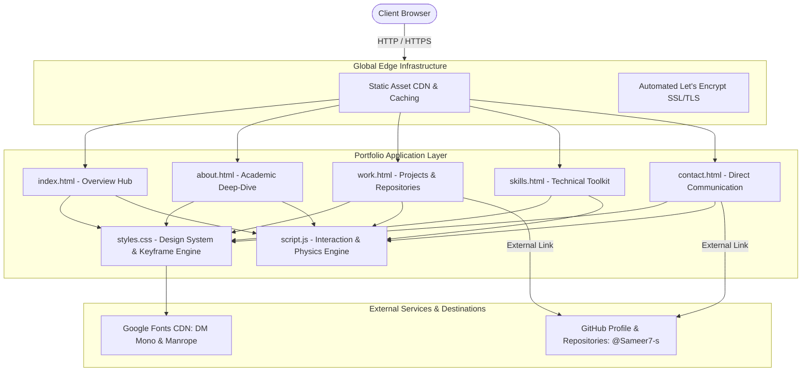
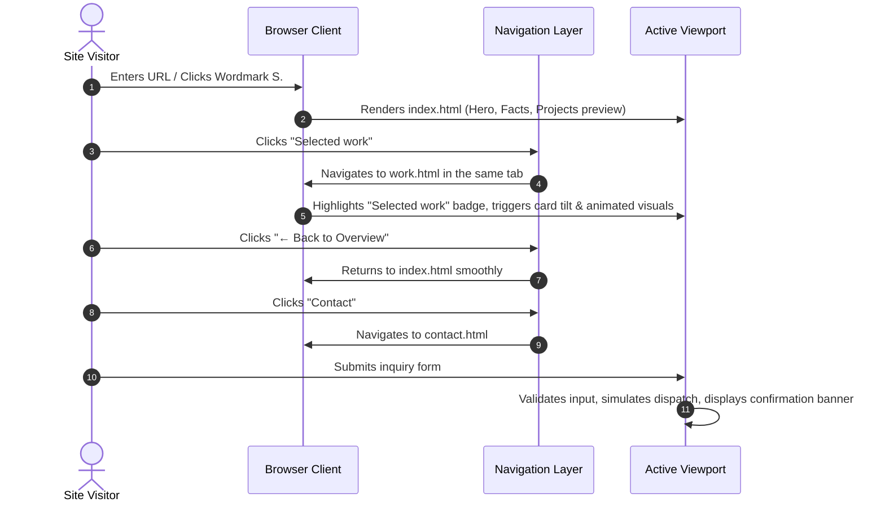
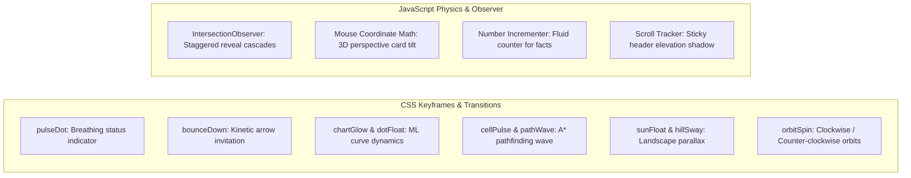

# System Architecture & Technical Design

## Sameer's Developer Portfolio

---

## 1. Executive Summary

This document provides a comprehensive technical overview of the architecture, design decisions, component patterns, animation engine, and deployment infrastructure powering **Sameer's Portfolio Website**.

The site serves as an authentic, high-performance showcase of Sameer's academic journey and practical engineering work as a **BCA student specializing in Artificial Intelligence and Machine Learning** based in Bengaluru, India.

### Key Architectural Tenets
- **Zero-Runtime Dependency:** Built with pure semantic HTML5, modern vanilla CSS3, and modern ECMAScript (ES6+) for maximum rendering speed, zero bundle bloat, and total longevity.
- **Editorial Design Language:** Custom typography pairing (`DM Mono` and `Manrope`), warm tactile background (`#f6f5f1`), high-contrast ink (`#1e2524`), and electric lime accents (`#b4f06a`).
- **Hardware-Accelerated Interaction:** GPU-accelerated micro-animations (`transform`, `opacity`, `will-change`) with spring cubic-bezier transitions and interactive 3D physics.
- **Hybrid Multi-Page Architecture:** Seamless same-window multi-page routing with deep-dive subpages (`about.html`, `work.html`, `skills.html`, `contact.html`) while preserving an all-in-one landing page (`index.html`).
- **Automated CI/CD:** Continuous deployment via GitHub git hooks into Vercel's global edge network.

---

## 2. High-Level Architecture Diagram



---

## 3. Directory & File Structure

```text
Sameer_Portfolio_Website/
└── sameer-portfolio/
    ├── index.html          # Main Portfolio Hub & Hero Overview
    ├── about.html          # In-depth Academic Profile & Philosophy
    ├── work.html           # Project Showcases, Algorithmic Visuals & GitHub Links
    ├── skills.html         # Technical Stack, Competency Badges & Roadmap
    ├── contact.html        # Direct Inquiry Channels & Interactive Form
    ├── styles.css          # Design Tokens, Layout Grids, Responsive Media & Animations
    ├── script.js           # Header Scroll State, Mobile Navigation, 3D Tilt & Counters
    ├── package.json        # Project Manifest & Local Development Script
    ├── ARCHITECTURE.md     # Technical Architecture & System Documentation (This File)
    └── README.md           # Project Readme & Overview
```

---

## 4. Component & Navigation Flow



---

## 5. Technology Stack & Decision Matrix

| Layer | Technology | Decision Rationale |
| :--- | :--- | :--- |
| **Markup** | HTML5 Semantic | Provides clean outline hierarchy (`<header>`, `<main>`, `<section>`, `<article>`, `<footer>`), optimal SEO, and screen-reader accessibility without framework overhead. |
| **Styling** | Vanilla CSS3 | Direct hardware-level styling with CSS custom properties (`:root`), Flexbox/Grid, and keyframe animations. Eliminates build-step dependencies. |
| **Scripting** | Vanilla ES6+ | Lightweight DOM manipulation, `IntersectionObserver` for zero-lag scroll reveals, and 3D card tilt physics using mouse coordinate tracking. |
| **Typography** | Google Fonts | `Manrope` (800/700/600/500/400) for editorial headlines; `DM Mono` (500/400) for telemetry, captions, code tags, and metrics. |
| **Deployment** | Vercel Edge | Instant global static asset CDN distribution, automated preview deployments, automatic HTTPS, and direct GitHub branch integration. |

---

## 6. Design System & CSS Token Architecture

The design system is managed globally via CSS variables in [`styles.css`](file:///c:/Users/samee/Downloads/Sameer_Portfolio_Website%20(1)/sameer-portfolio/styles.css):

```css
:root {
  --paper: #f6f5f1;   /* Warm editorial cream background */
  --ink:   #1e2524;   /* Deep charcoal primary text and headings */
  --muted: #727874;   /* Balanced neutral for secondary labels */
  --line:  #d9dcd5;   /* Subtle structural border divider */
  --accent:#b4f06a;   /* Vibrant electric lime for focus and highlights */
  --deep:  #24372f;   /* Forest green dark theme for featured cards */
  --mono:  "DM Mono", monospace;
  --sans:  "Manrope", sans-serif;
}
```

### Visual Texture & Atmosphere
- **SVG Fractal Grain Overlay:** A fixed, non-blocking `div.grain` with an inline SVG fractal noise filter creates an authentic, tactile printed-paper feel across the entire viewport.
- **Glassmorphism Header:** `backdrop-filter: blur(16px)` with semi-transparent background (`rgba(246, 245, 241, 0.92)`) provides consistent hierarchy as content scrolls beneath.

---

## 7. Animation, Micro-Interaction & Physics Engine



### 1. Interactive 3D Card Tilt
On pointer devices (`pointer: fine`), project cards track the mouse position relative to card center, computing dynamic pitch and roll angles:
$$\text{rotateX} = \frac{y - \text{centerY}}{\text{centerY}} \times -3^\circ$$
$$\text{rotateY} = \frac{x - \text{centerX}}{\text{centerX}} \times 3^\circ$$
Combined with `perspective(1000px)`, this provides a subtle, luxury tactile feedback without distorting readability.

### 2. Animated Algorithmic & ML Visuals
- **Machine Learning (`.visual-ml`):** Floating data coordinates with varied delay offsets simulate active scatter plot data generation; glowing regression line draws focus.
- **A* Search (`.visual-algo`):** Visited and path coordinate grid cells alternate opacity and background tone with timed keyframes, emulating real-time graph traversal.
- **Smriti Rekha (`.visual-memory`):** Floating radiant sun coupled with subtle hill parallax transforms on card hover.

### 3. Number Counter Engine
Fact values (`03` for current semester, `2028` for graduation year) automatically animate when scrolled into view, utilizing decoupled `setInterval` counters triggered via `IntersectionObserver`.

---

## 8. Performance & Accessibility (a11y)

### Performance Optimizations
- **Composite-Only Properties:** Key animations strictly manipulate `transform` and `opacity` to avoid browser layout thrashing and repaint costs.
- **`will-change` Declarations:** Applied judiciously on active animated elements (`.reveal`, `.project-card`) to promote elements to dedicated GPU layers.
- **Font Optimization:** Google Fonts preconnected with `crossorigin` to eliminate render-blocking round trips.

### Accessibility Safeguards
- **Reduced Motion Support:** A full `@media (prefers-reduced-motion: reduce)` query block neutralizes animations, disables keyframe durations, and sets reveal elements to instant visibility.
- **ARIA & Keyboard Navigation:** Mobile navigation toggle includes `aria-expanded` and `aria-label` synchronized dynamically; escape key closes mobile menu cleanly.
- **Semantic Contrast:** High contrast ratio between `--ink` and `--paper` exceeds WCAG AA standards.

---

## 9. CI/CD & Deployment Pipeline

```mermaid
gitGraph
    commit id: "Initial code"
    commit id: "Navbar polish"
    commit id: "Subpages added"
    branch main
    checkout main
    commit id: "Same-tab routing"
    commit id: "Animation engine"
    commit id: "Architecture doc"
    checkout main
    merge main id: "Deploy trigger"
```

1. **Local Development:** `npm start` runs `npx --yes serve -l 8000 .` for instant local inspection.
2. **Version Control:** All features committed to GitHub (`Sameer7-s/PortFolio`) on branch `main`.
3. **Automated Webhook:** GitHub pushes immediately ping Vercel.
4. **Vercel Build:** Configured with Root Directory `sameer-portfolio`, deploying static assets instantly without build step latency.
5. **Global Edge Distribution:** Output cached across Vercel's multi-region edge nodes worldwide.

---

## 10. Future Architectural Roadmap

- [ ] **Interactive A* Canvas:** Full interactive pathfinding sandbox allowing visitors to place custom start/end nodes and obstacles on a live grid.
- [ ] **Model Playground:** Client-side TensorFlow.js or ONNX model inference demonstration embedded directly within `work.html`.
- [ ] **Dynamic Theme Switcher:** Monochromatic dark mode toggle respecting system preferences while preserving the editorial character.

---
*Maintained by Sameer · Bangalore, India · Updated 2026*
